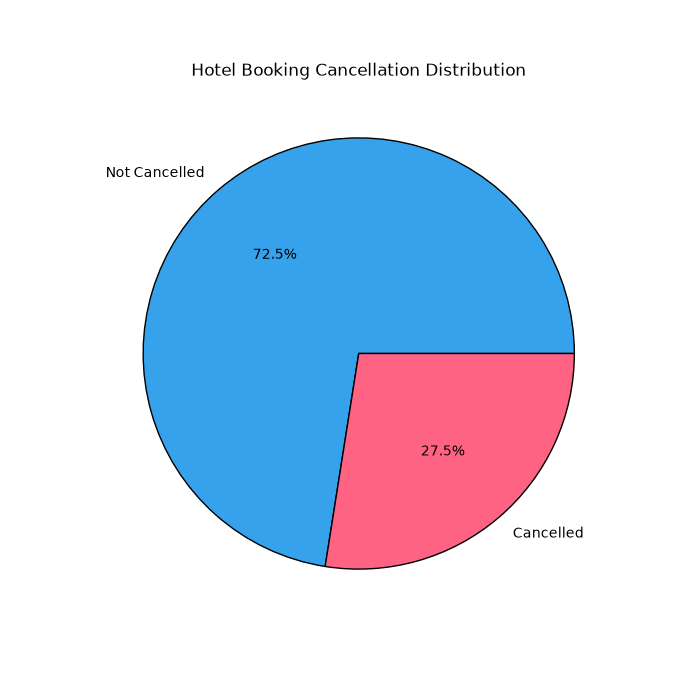
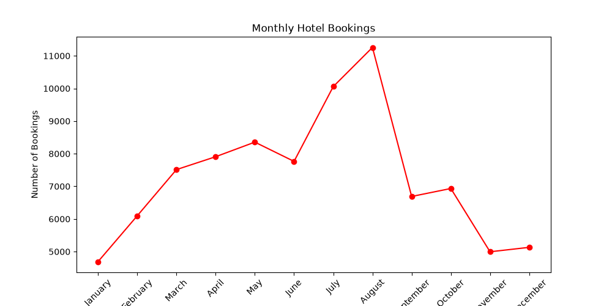
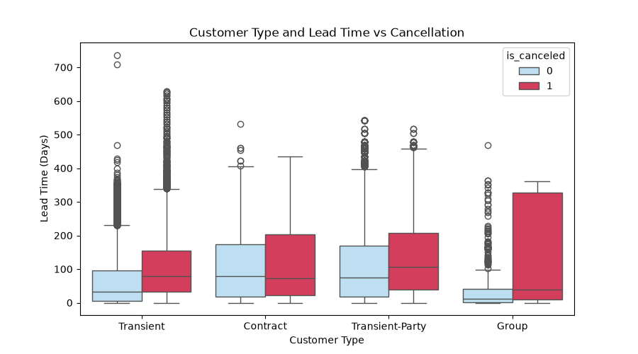
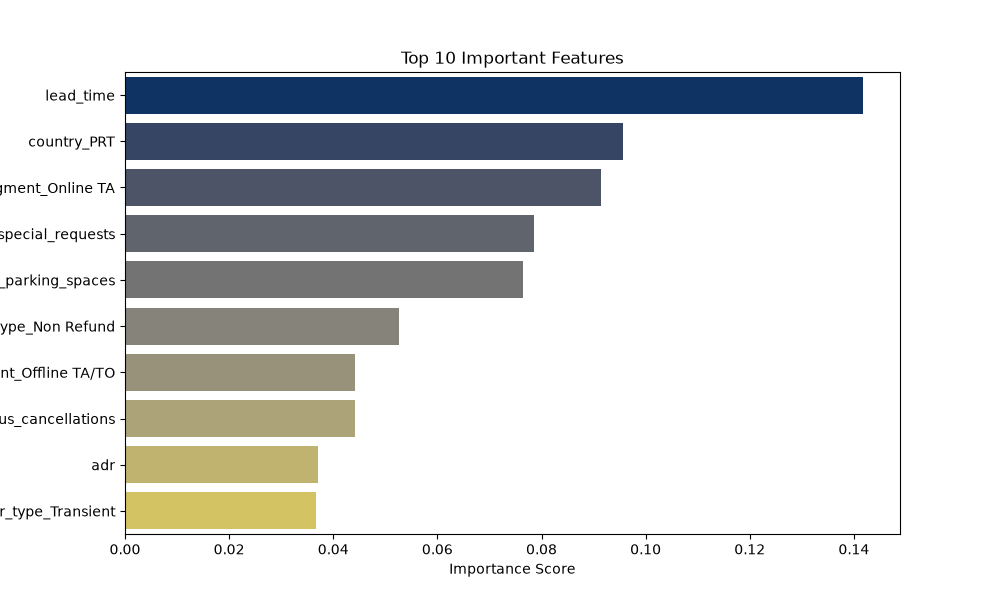
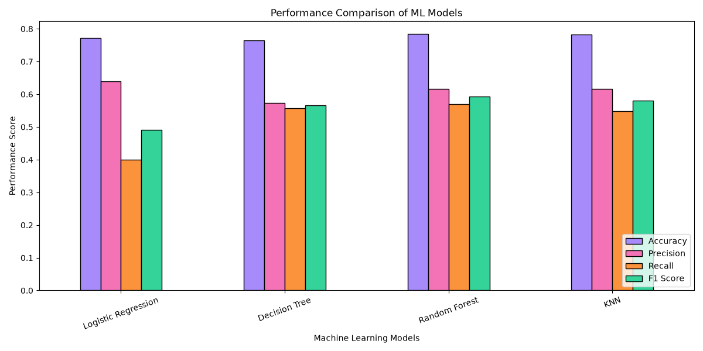

# 🏨 Hotel Booking Cancellation Prediction
An end-to-end machine learning project that analyzes 119,390 hotel bookings (City Hotel and Resort Hotel) and predicts which bookings are likely to be cancelled.

## 📌 Overview
Cancellations hurt hotel revenue and planning. This project cleans the data, explores cancellation patterns, selects the most important features, and compares four classification models.

## 🛠️ Technologies
Python, Pandas, NumPy, Matplotlib, Seaborn, Scikit-learn

## 📁 Project Structure

- `data_cleaning.py` : Step 1: removes duplicates and handles missing values
- `EDA.py` : Step 2: exploratory data analysis and charts
- `feature_selection.py` : Step 3: correlation analysis and Random Forest feature importance
- `model_training.py` : Step 4: trains 4 models and prints accuracy
- `model_comparison.py` : Step 5: compares models (accuracy, precision, recall, F1)
- `hotel_bookings.csv` : Raw dataset (119,390 rows)
- `hotel_bookings_cleaned.csv` : Output of `data_cleaning.py` (87,396 rows)
- `selected_features_dataset.csv` : Output of `feature_selection.py` (top 10 features + target)
- `images/` : Charts used in this README
- `requirements.txt` : Python libraries needed to run the project

## 🔄 Project Workflow
1. **Data cleaning:** removed 31,994 duplicates; filled missing values in `children`, `country`, `agent`, `company`
2. **EDA:** cancellation distribution, hotel type, monthly trends, lead time, ADR, correlation heatmap
3. **Feature selection:** removed leakage columns (`reservation_status`, `reservation_status_date`), then used Random Forest feature importance to pick the top 10 features
4. **Model training:** Logistic Regression, Decision Tree, Random Forest, KNN (80/20 stratified split)
5. **Model comparison:** accuracy, precision, recall, F1 score and confusion matrices

## ✨ Key Insights
- 27.5% of bookings are cancelled; City Hotel (30.0%) vs Resort Hotel (23.5%)
- Cancellations peak in summer (August: 32.2%)
- Median lead time: 80 days (cancelled) vs 38 days (not cancelled)
- Online travel agent bookings cancel at 35.3%; corporate at 12.1%
- Guests with special requests or parking needs cancel far less

## 🏆 Model Results
| Model | Accuracy | Precision | Recall | F1 Score |
|---|---|---|---|---|
| Logistic Regression | 0.773 | 0.639 | 0.399 | 0.491 |
| Decision Tree | 0.765 | 0.574 | 0.559 | 0.566 |
| **Random Forest** | **0.783** | 0.614 | 0.568 | **0.590** |
| KNN | 0.782 | 0.617 | 0.550 | 0.581 |

Random Forest performed best overall.

## 📊 Visuals






## ▶️ How to Run
```bash
git clone https://github.com/<your-username>/hotel-booking-cancellation-prediction.git
cd hotel-booking-cancellation-prediction
pip install -r requirements.txt

python data_cleaning.py
python EDA.py
python feature_selection.py
python model_training.py
python model_comparison.py

Run the scripts in this order. Each script reads the CSV produced by the previous one, which are already included, so you can also run any script on its own. Charts open one after another; close each window to continue.
```

## 🚀 Future Improvements
- Hyperparameter tuning (GridSearchCV)
- Handle outliers in `adr`
- Improve recall to catch more real cancellations
- Try XGBoost / handle class imbalance

## 👤 Author
**Rohit** | [LinkedIn](https://www.linkedin.com/feed/update/urn:li:activity:7522354919073546240/)
